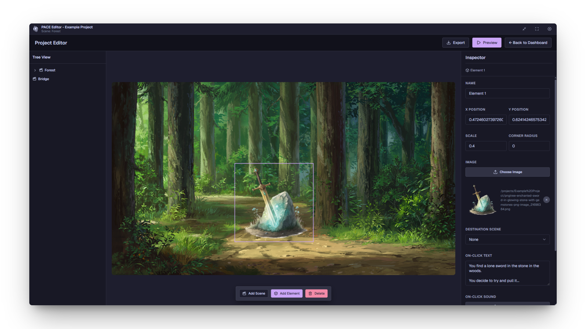
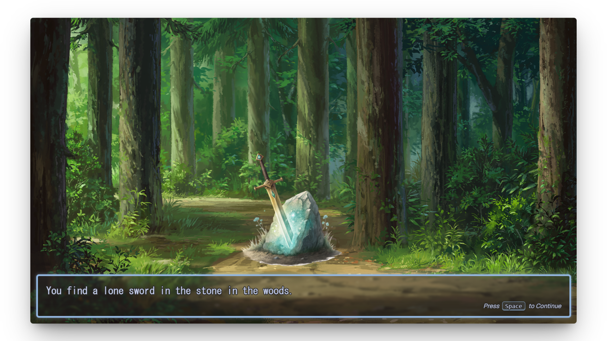

# PACE


> An extremely rudimentary HTML5-export-based game engine and editor for simple point-and-click adventure games.

PACE provides a scene-based editor with drag-and-drop positioning, a scene tree and property inspector, text system, audio management, instant preview, and exports directly to organized HTML, CSS, and JavaScript.

## Screenshots




## Motivations

- **Simple**: Extremely simple and intuitive to use, with a visual editor and fast previews.
- **Specific**: Designed to be feature-thin and have exactly the features I need.
- **Hackable**: Export to simple, organized, and readable web formats so that exports can be modified incredibly easy with simple CSS and JavaScript.

## Documentation

Complete documentation is available at **[https://ruelalarcon.github.io/pace/](https://ruelalarcon.github.io/pace/)**

- [Getting Started Guide](https://ruelalarcon.github.io/pace/#/getting-started) - Create your first project
- [Scenes](https://ruelalarcon.github.io/pace/#/scenes) - Scene creation and management
- [Elements](https://ruelalarcon.github.io/pace/#/elements) - Interactive element system
- [Text System](https://ruelalarcon.github.io/pace/#/text-system) - Dialogue and character portraits
- [Audio System](https://ruelalarcon.github.io/pace/#/audio-system) - Music and sound effects
- [Preview & Export](https://ruelalarcon.github.io/pace/#/preview-export) - Test and publish your games
- [Customization](https://ruelalarcon.github.io/pace/#/customization-css) - Advanced CSS and JavaScript customization

## Quick Installation

Pre-built releases are available for Windows and Linux:

1. Download the appropriate file for your operating system:
   - **Windows (Installer):** [pace_v1.0.0_windows_x64.exe](https://github.com/ruelalarcon/pace/releases/download/v1.0.0/pace_v1.0.0_windows_x64.exe)
   - **Windows (Portable):** [pace_v1.0.0_windows_x64_portable.zip](https://github.com/ruelalarcon/pace/releases/download/v1.0.0/pace_v1.0.0_windows_x64_portable.zip)
   - **Linux (AppImage):** [pace_v1.0.0_linux_x86_64.AppImage](https://github.com/ruelalarcon/pace/releases/download/v1.0.0/pace_v1.0.0_linux_x86_64.AppImage)
   - **Linux (Portable):** [pace_v1.0.0_linux_x64_portable.zip](https://github.com/ruelalarcon/pace/releases/download/v1.0.0/pace_v1.0.0_linux_x64_portable.zip)

2. Install or extract the application:
   - **Windows Installer:** Run the `.exe` and follow the setup wizard
   - **Windows Portable:** Extract the ZIP and run `pace.exe`
   - **Linux AppImage:** Make executable with `chmod +x` and run
   - **Linux Portable:** Extract, make executable with `chmod +x pace`, and run

3. Launch PACE and start creating!

For detailed installation instructions and troubleshooting, see the [Installation Guide](https://ruelalarcon.github.io/pace/#/installation).

## Features

- **Visual Scene Editor**: Drag-and-drop interface for positioning elements
- **No Coding Required**: Build complete games through the visual interface
- **Text & Dialogue System**: Support for character portraits, dialogue text, and custom styling
- **Audio Management**: Background music and sound effects per scene
- **Interactive Elements**: Clickable objects with navigation and custom actions
- **Instant Preview**: Test your game without exporting
- **Export to HTML**: Standalone game files that run in any browser
- **Project Management**: Dashboard for organizing multiple projects

## Project Structure

Your projects are stored in the following locations:

| Platform    | Default Project Location   |
| ----------- | -------------------------- |
| **Windows** | `%APPDATA%\pace\Projects\` |
| **Linux**   | `~/.config/pace/Projects/` |

Each project contains:

- `project.json` - Project metadata and scene definitions
- Images, audio, and other media files

## Building from Source

If you prefer to build the application from source, you'll need [Node.js](https://nodejs.org/) (v18 or later) installed on your system.

### Prerequisites

- Node.js 18+ and npm
- Git

### Building

Clone this repository and navigate to the directory:

```bash
git clone https://github.com/ruelalarcon/pace.git
cd pace
```

Install dependencies:

```bash
npm install
```

### Development Commands

```bash
# Development with hot reload
npm run dev

# Building
npm run build

# Code quality
npm run lint
npm run lint:fix
npm run format
npm run format:check

# Testing
npm test

# Distribution builds
npm run dist           # All platforms
npm run dist-win       # Windows
npm run dist-mac       # macOS
npm run dist-linux     # Linux
npm run dist-dir       # Directory only (no installer)
```

### Build System

- **electron-vite**: Build tool for main, preload, and renderer processes
- **React 19**: Frontend UI framework
- **TypeScript**: Type safety throughout the codebase
- **Express 5**: Embedded backend server for project management

## Architecture

### Frontend (Renderer Process)

- React + TypeScript UI
- Component-based architecture (`src/components/`)
- Game engine runtime (`src/engine/Engine.js`)

### Backend (Main Process)

- Electron main process for window management
- Embedded Express server for:
  - Project CRUD operations
  - File upload/management
  - Game export functionality

### Key Technologies

- **Electron 38**: Cross-platform desktop framework
- **React 19**: UI framework
- **Express 5**: Backend server
- **CWebP**: Image processing
- **FFmpeg**: Video/audio processing
- **JSZip**: Game export archives

## Contributing

Contributions are welcome! Please feel free to submit pull requests, report bugs, or request features.

### Development Guidelines

- Follow the existing code style (ESLint + Prettier configured)
- Write TypeScript with strict mode
- Keep components modular and reusable
- Test your changes thoroughly

## License

This project is licensed under the MIT License - see the LICENSE file for details.

## Support

If you encounter issues or have questions:

1. Check the [Documentation](https://ruelalarcon.github.io/pace/)
2. Search [GitHub Issues](https://github.com/ruelalarcon/pace/issues)
3. Create a new issue with:
   - Your operating system and version
   - PACE version you're using
   - Steps to reproduce the problem
   - Any error messages or screenshots
